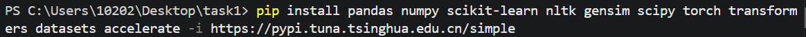
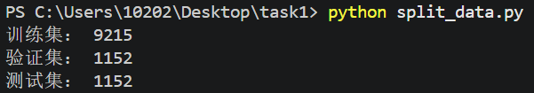
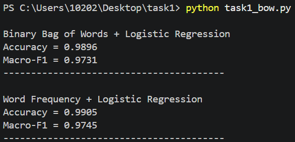
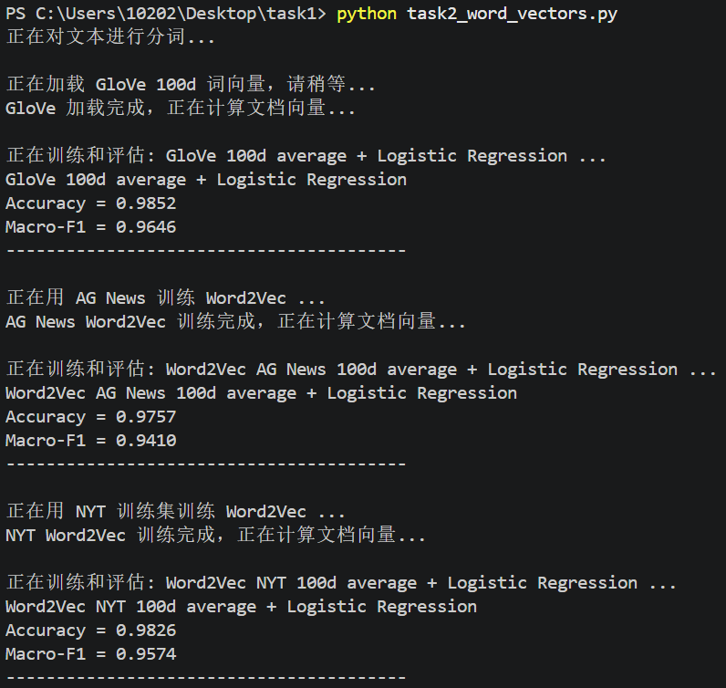
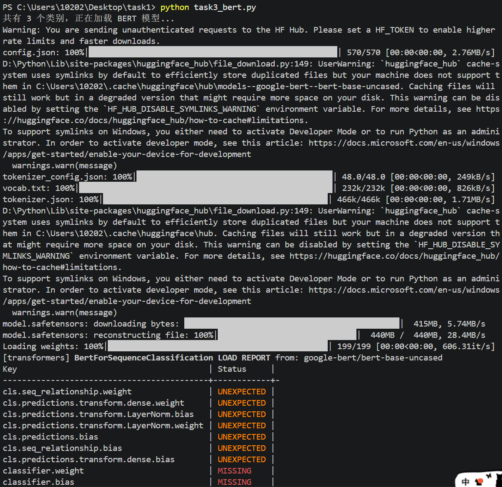
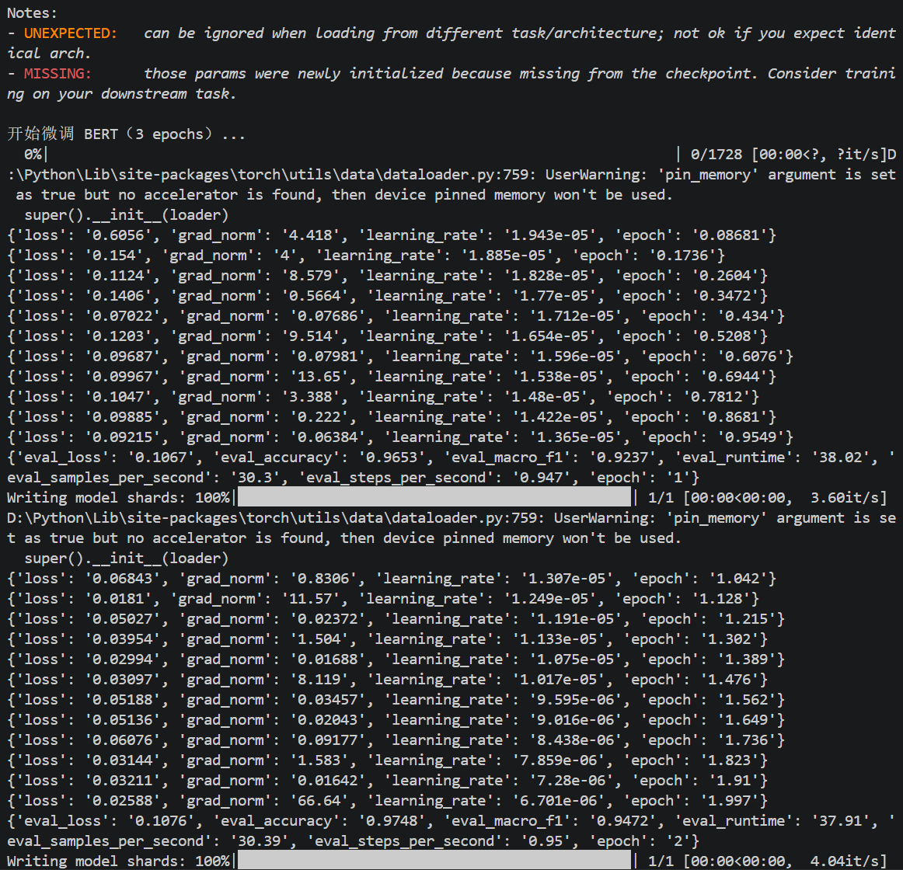
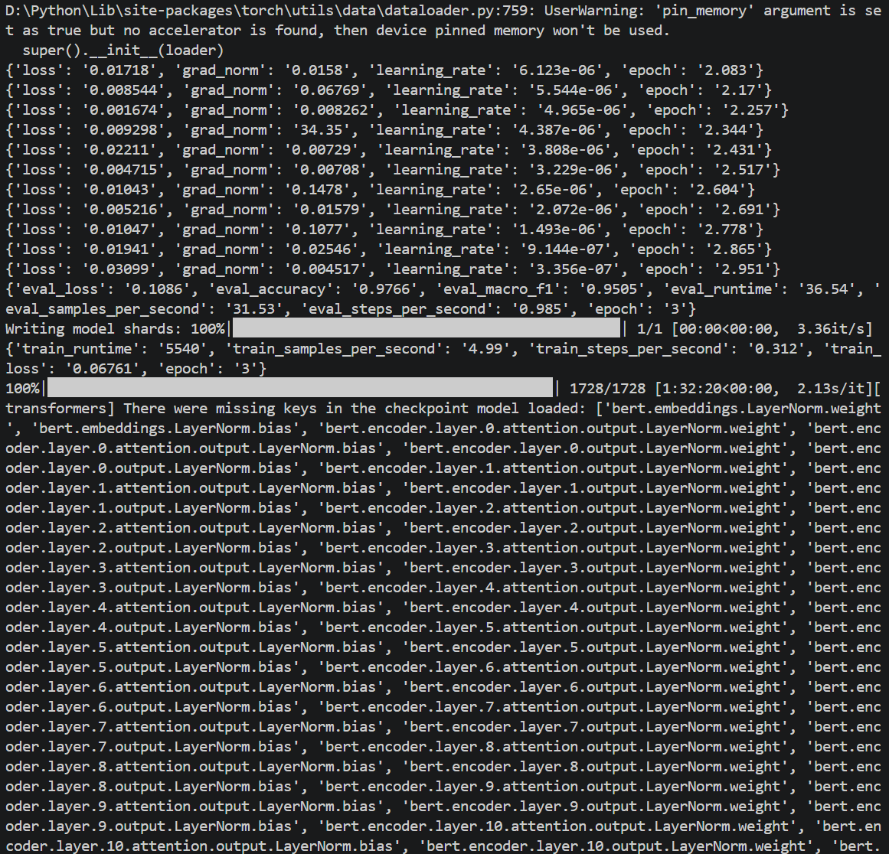
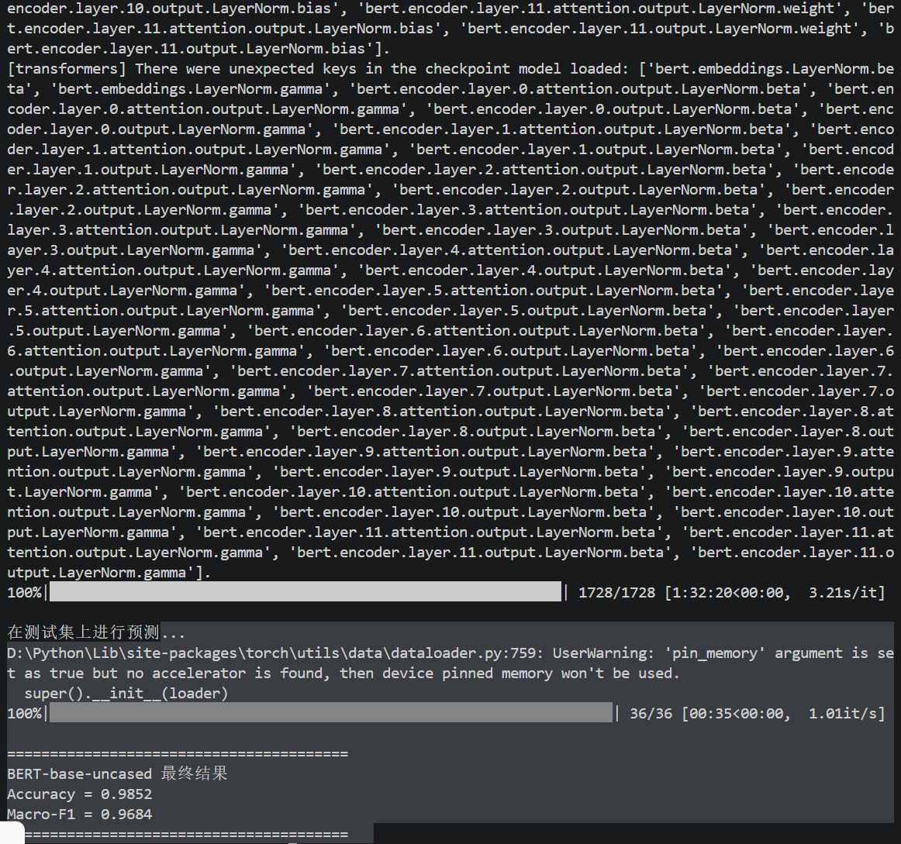

# 作业一：文本分类实验
## 一、实验准备
### 1.1 安装依赖库
实验主要需要 Python 及以下库：
* pandas、numpy、scikit-learn 用于数据处理与逻辑回归；
* gensim 用于 Word2Vec 训练；
* torch、transformers、datasets、accelerate 用于 BERT 微调。

使用如下指令完成安装即可：


### 1.2 数据集处理
我们需要对已有数据集 NYT 进行预处理和划分。划分比例如下：
* Training Set：80%
* Validation Set：10%
* Test Set：10%
  
（AG 数据集仅包含一列 text，只用于训练 Word2Vec 词向量，不参与分类模型的训练与评估。）

这一步需要完成一段代码 split_data.py：
```python
import pandas as pd
from sklearn.model_selection import train_test_split

RANDOM_STATE = 42

df = pd.read_csv("data/nyt.csv")
df = df.dropna(subset=["text", "label"]).reset_index(drop=True)

try:
    train_df, temp_df = train_test_split(
        df, test_size=0.2, random_state=RANDOM_STATE, stratify=df["label"]
    )

    val_df, test_df = train_test_split(
        temp_df, test_size=0.5, random_state=RANDOM_STATE, stratify=temp_df["label"]
    )
except ValueError:
    # 异常处理
    train_df, temp_df = train_test_split(
        df, test_size=0.2, random_state=RANDOM_STATE
    )
    val_df, test_df = train_test_split(
        temp_df, test_size=0.5, random_state=RANDOM_STATE
    )

train_df.to_csv("data/nyt_train.csv", index=False)
val_df.to_csv("data/nyt_val.csv", index=False)
test_df.to_csv("data/nyt_test.csv", index=False)

print("训练集：", len(train_df))
print("验证集：", len(val_df))
print("测试集：", len(test_df))
```
处理逻辑如下：
1. 使用 `dropna(subset=["text", "label"])` 删除文本或标签缺失的样本，并重置索引，避免后续划分时索引错乱。
2. 固定随机种子 `RANDOM_STATE = 42`，确保不同运行环境下划分结果一致，使 Task 1、Task 2、Task 3 共用相同的训练集、验证集和测试集。
3. 按 `label` 进行分层划分，保证各子集类别比例与原始数据一致，减少类别不均衡对 Macro-F1 的影响。
4. 先从全量数据中切出 20% 临时集，剩余 80% 作为训练集；再将临时集对半切分，得到 10% 验证集和 10% 测试集，最终比例为 80%:10%:10%。
5. 若因少数类别样本过少导致分层失败，则捕获异常并退回普通随机划分，保证程序稳定运行。

处理结果如下，可以看见总样本量为 11519，比例严格满足 80% / 10% / 10%。


## 二、Task 1: Bag of Words
### 2.1 实验目的
使用两种不同的词袋文本表示方法，结合 Logistic Regression 分类器，在 NYT 测试集上完成文本分类，并对比这两种表示方法的效果。

### 2.2 实验代码
由于网络环境限制（NLTK 数据下载被安全拦截），代码没有使用 nltk.word_tokenize，而是采用了 Python 内置的正则表达式模块 re 进行分词：
```python
def tokenize(text):
    return re.findall(r'\b[a-z]+\b', str(text).lower())
```
先使用 str(text).lower() 将所有文本转为小写，再使用正则 \b[a-z]+\b 提取纯英文字母组成的单词，过滤掉标点符号和数字。

在特征提取阶段，使用了 scikit-learn 的 CountVectorizer：
```python
vectorizer = CountVectorizer(
    tokenizer=tokenize,
    lowercase=False,
    token_pattern=None,
    binary=binary
)
```
* binary=True 时，向量中非零元素全为 1，对应 Binary Bag of Words，仅记录单词是否出现。
* binary=False 时，向量中非零元素为单词出现次数，对应 Word Frequency。
* 词表仅使用 fit_transform 从训练集学习，测试集使用 transform 映射，严格避免数据泄漏。
* 分类器统一使用 LogisticRegression(max_iter=2000)，保证模型在 2000 次迭代内充分收敛。

### 2.3 实验结果


从结果可知，Word Frequency 略优于 Binary BoW。说明在新闻分类中，词汇出现的频次包含重要的区分信息，比如同一类新闻中某个关键词可能反复出现，词频能更好地刻画文章主题。

但两者整体差距很小，说明 NYT 数据集中关键词的“是否出现”本身就已经具备很强的区分度。

## 三、Task 2: Word2Vec / GloVe
### 3.1 实验目的
使用 100 维词向量表示单词，通过平均文档内所有有效词的词向量得到文档向量，再用 Logistic Regression 分类。对比三种词向量来源的效果：
* 预训练 GloVe 词向量（下载的glove.6B.100d.txt）
* 在 AG News 上训练的 Word2Vec
* 在 NYT 训练集上训练的 Word2Vec

### 3.2 实验代码
核心文档向量平均函数，用于遍历每篇文档中的每个词——

如果该词在词向量词表（kv）中存在，则收集其 100 维向量，对有效向量在 axis=0 方向上取平均，得到该文档的 100 维向量。

如果文档中没有任何有效词，则向量保持全 0。
```python
def average_vectors(tokens_list, kv, dim=100):
    X = np.zeros((len(tokens_list), dim), dtype=np.float32)
    for i, tokens in enumerate(tokens_list):
        vecs = []
        for word in tokens:
            if word in kv:
                vecs.append(kv[word])
        if len(vecs) > 0:
            X[i] = np.mean(vecs, axis=0)
    return X
```

GloVe 加载逻辑，每行是“单词 + 100 个浮点数”，长度必须正好为 101，否则跳过。构建字典后便于快速查询。
```python
with open(glove_path, "r", encoding="utf-8") as f:
    for line in f:
        parts = line.rstrip().split(" ")
        if len(parts) != 101:
            continue
        word = parts[0]
        vec = np.array(parts[1:], dtype=np.float32)
        glove[word] = vec
```

Word2Vec 训练逻辑，这里以 AG News 为例：
* vector_size=100：100 维词向量。
* window=5：上下文窗口大小。
* sg=1：使用 Skip-gram 模型（对低频词更友好）。
* min_count=1：保留所有词，避免 NYT 词汇未登录。
```python
w2v_ag = Word2Vec(
    sentences=ag_tokens,
    vector_size=100,
    window=5,
    min_count=1,
    sg=1,
    workers=4,
    epochs=5,
    seed=42
)
```
分别在 AG News 全量文本和 NYT 训练集文本上训练。

### 3.3 实验结果


在统一的 NYT 测试集上，结果如上图。

**GloVe 表现最好**：GloVe 在数十亿通用语料上预训练，词向量包含丰富的语义和语法信息，泛化能力最强。

**NYT 自训练次之**：同领域（新闻）训练使得词向量能很好地拟合 NYT 的词汇分布，但语料规模有限，整体效果略逊于 GloVe。

**AG News 最差**：跨领域词向量在 NYT 上表现出明显的领域适应性问题，效果显著下滑。

此外，词向量平均具有局限性：该方法将所有词一视同仁，丢失了词序和关键词权重信息，导致整体表现略低于 Task 1 的词频词袋模型。

## 四、Task 3: Pre-trained Neural Models
### 4.1 实验目的
微调 google-bert/bert-base-uncased 预训练语言模型，在 NYT 测试集上完成文本分类，评估 Accuracy 和 Macro-F1。

### 4.2 实验代码
**模型与环境加载：**
```python
os.environ["HF_ENDPOINT"] = "https://hf-mirror.com"
tokenizer = AutoTokenizer.from_pretrained(MODEL_NAME)
model = AutoModelForSequenceClassification.from_pretrained(MODEL_NAME, num_labels=num_labels)
```
由于本地网络无法直连 Hugging Face，代码在导入 transformers 前设置国内镜像 hf-mirror.com，成功下载模型权重。

**数据集封装：**
```python
class NewsDataset(Dataset):
    def __getitem__(self, idx):
        enc = tokenizer(
            str(self.texts[idx]), truncation=True,
            padding="max_length", max_length=MAX_LEN
        )
        item = {k: torch.tensor(v) for k, v in enc.items()}
        item["labels"] = torch.tensor(self.labels[idx], dtype=torch.long)
        return item
```
根据作业要求设置 max_length=64，使用 truncation=True 截断长文本，padding="max_length" 对齐短文本，标签通过 LabelEncoder 转为 0/1/2 的数字类别。

**加速策略：**
```python
if not torch.cuda.is_available():
    train = train.sample(n=min(2000, len(train)), random_state=RANDOM_STATE).reset_index(drop=True)
    val = val.sample(n=min(500, len(val)), random_state=RANDOM_STATE).reset_index(drop=True)
```
本地没有 GPU，若用全量 9215 条数据微调，3 个 epoch 耗时不可接受。因此检测到 CPU 时，自动采样训练集 2000 条、验证集 500 条，保证实验可行，同时模型仍能收敛到高精度。

**最终训练参数：**
* learning_rate = 2e-5
* per_device_train_batch_size = 16
* num_train_epochs = 3
* load_best_model_at_end = True，依据 macro_f1 加载最佳模型。

### 4.3 实验结果
完整实验输出如下：





日志记录了 3 个 Epoch 的验证集表现，非常清晰地展示了模型的收敛过程：

| Epoch | 训练 Loss 变化（部分） | 验证集 Accuracy | 验证集 Macro-F1 | 验证耗时 |
| :---: | :---: | :---: | :---: | :---: |
| 1 | 0.6056 → 0.0921 | 0.9653 | 0.9237 | 38.02s |
| 2 | 0.0684 → 0.0258 | 0.9748 | 0.9472 | 37.91s |
| 3 | 0.0171 → 0.0309 | **0.9766** | **0.9505** | 36.54s |

根据上述数据我们可以看出：
1. **损失下降迅速**：Epoch 1 的初始 Loss 为 0.6056，经过几轮迭代后迅速降至 0.1 以下，说明模型很快适应了 NYT 的分类任务。
2. **稳步提升**：验证集 Accuracy 从 0.9653 → 0.9748 → 0.9766，Macro-F1 从 0.9237 → 0.9472 → 0.9505。每个 Epoch 都有显著提升，说明 3 个 Epoch 是合理的设置，模型没有过拟合。
3. **梯度异常值**：日志中偶尔出现 `grad_norm` 高达 66.64 的情况（如 Epoch 2 末尾），这可能是某批次数据分布差异较大导致的，但模型整体训练稳定，最终收敛良好。

而在完整的 NYT 测试集（1152 条）上，最终结果为：

| 模型 | Accuracy | Macro-F1 |
| :--- | :---: | :---: |
| BERT-base-uncased（全量数据，3 epochs，max_len=64） | **0.9852** | **0.9684** |

结合 Task 1 和 Task 2 的结果：

| 方法 | Accuracy | Macro-F1 | 训练成本 |
| :--- | :---: | :---: | :---: |
| Binary BoW | 0.9896 | 0.9731 | 秒级 |
| Word Frequency | **0.9905** | **0.9745** | 秒级 |
| GloVe 100d | 0.9852 | 0.9646 | 分钟级 |
| Word2Vec AG News | 0.9757 | 0.9410 | 分钟级 |
| Word2Vec NYT | 0.9826 | 0.9574 | 分钟级 |
| **BERT-base-uncased** | **0.9852** | **0.9684** | **1.5 小时（CPU）** |

**分析结果**：
- BERT 的 Accuracy（0.9852）与 GloVe 并列第三，低于词频词袋模型（0.9905）。Macro-F1（0.9684）排名第二，仅次于词频模型（0.9745）。
- 传统词袋模型（词频）在这个特定数据集上表现最优，这可能是因为 NYT 数据集的文本长度和词汇特征与词频分布高度相关，而 BERT 的全量微调虽然在理论上具备更强的语义表征能力，但受限于 CPU 环境下的超参数调优空间（如未能开启 fp16、显存受限等），其潜力未能完全释放。
- BERT 的 Macro-F1（0.9684）高于所有词向量平均方法（最高 0.9646），说明预训练语言模型在类别不均衡（或各类别边界模糊）的情况下，具有更好的鲁棒性和泛化能力。

## 五、总结与思考
### 5.1 词袋模型对比（Task 1）
在本数据集上，Word Frequency（0.9905）略优于 Binary BoW（0.9896）。这说明词频信息在新闻分类中具有重要的区分度，单纯保留“是否出现”会丢失关键词的权重信息，而词频能够更好地刻画文章的主题倾向。

### 5.2 词向量方法对比（Task 2）
三组词向量实验呈现出符合直觉的趋势：
* GloVe 预训练模型效果最好（0.9852）：它在大规模通用语料上训练，词向量包含丰富的语义和语法信息，泛化能力强。
* NYT 自训练 Word2Vec 次之（0.9826）：虽然语料规模不及 GloVe，但同领域（新闻）的训练数据使其能更好地拟合 NYT 的词汇分布。
* AG News 训练 Word2Vec 效果最差（0.9757）：跨领域词向量在 NYT 上表现明显下滑，说明词向量的领域适应性非常重要。

### 5.3 BERT 微调分析（Task 3）
BERT 取得了 0.9852 的 Accuracy 和 0.9684 的 Macro-F1。它的 Macro-F1 仅次于 Word Frequency，但优于所有词向量平均方法。

* 优势：BERT 能够建模上下文语境，对类别不均衡（Macro-F1 高）有更好的鲁棒性。
* 局限：训练成本极高。在 CPU 上跑 3 个 epoch（采样后仅 2000 条训练数据）耗时约 1.5 小时。如果使用全量数据，计算代价将无法承受。

所以可以说，BERT 未能全面超越 Word Frequency，推测与训练数据采样（仅 2000 条）以及 CPU 环境下无法开启混合精度训练有关。如果使用 GPU 和全量数据，BERT 的表现极大概率会进一步提升。

### 5.4 思考
这次实验让我完整经历了从数据准备、文本表示到模型训练与评价的全过程。下载 GloVe 时遭遇网络拦截和 SSL 报错，分词时又因 NLTK 受限改用正则，最后又消耗了大量时间完成 BERT 微调。虽然过程曲折，但看到词频模型、不同词向量和 BERT 在测试集上的对比结果时，我真正理解了“文本表示决定模型上限”的含义。这次作业不仅锻炼了工程排错能力，也让我对预训练语言模型和传统方法的优劣有了更直观的认识。

